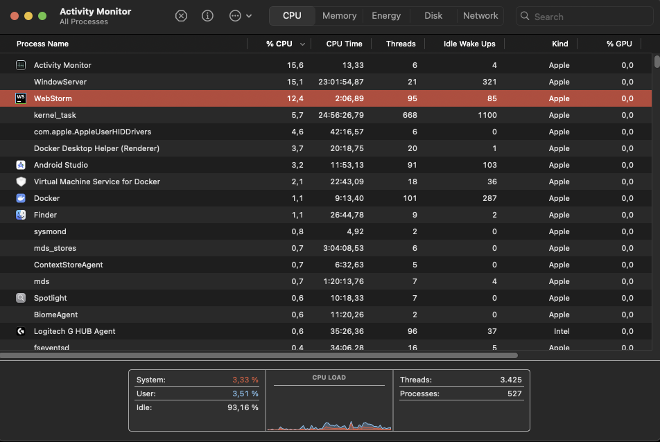
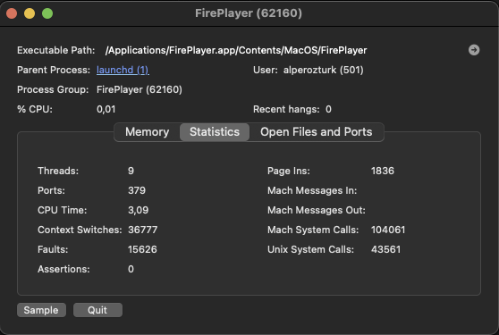
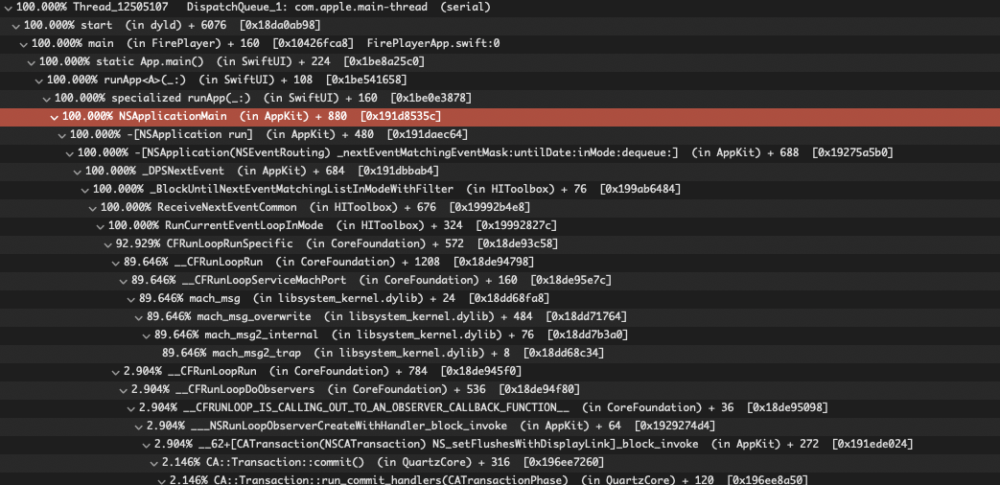
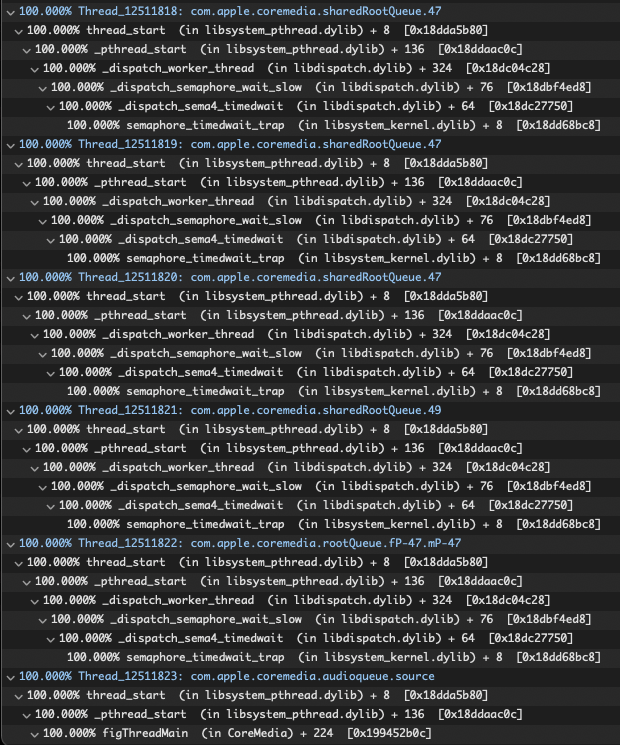
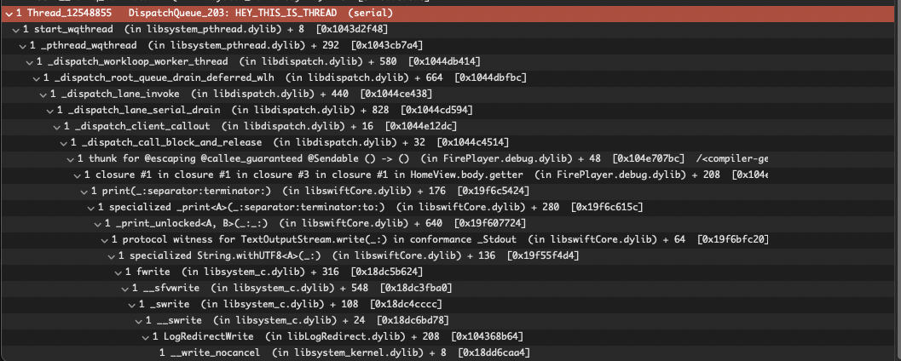

Many engineers are familiar with terms like “concurrency”, “deadlock”, “thread” but sometimes the precise meanings can be a bit unclear.

I hear a lot:

- “This should belong to the I/O thread.”
- “The app will crash otherwise.”
- “Why is there a mutex here?”
- “Shall we use semaphore?”
- “How did this code introduce a race condition?”
- “Can synchronized block solve this?”

Before relying on memorized code or common answers, it’s valuable to truly understand what these concepts mean and why they matter.

# Being Skeptical

I have always been curious. I constantly ask “why” and “how.” I find that questioning and seeking clarity leads to deeper understanding. Being skeptical about technical matters has always helped me.

When I come across new ideas or claims, I take the time to explore and verify them before accepting them as truth.

I’ll try to summarize concurrency. If you spot any errors or have clearer explanations, feel free to contact me.

# Instruction Hierarchy

Computers only understand 0s and 1s. Over time, great engineers have helped us develop ways to write code that is more understandable to humans. Eventually, that code gets translated down to the computer's level into 0s and 1s.

If we were to put this into a hierarchy, it might look like this:

1. 0s and 1s (machine code)
2. Assembly
3. Programming Languages (C, Java, Swift, ...)

# What is a Program?

A program is the set of instructions stored on disk or in memory.

# What Is a Process?

When you launch a program, the operating system creates a process. It's an instance of program.

# So?

Sometimes, analogies can make things harder to understand. I’m not going to give you an irrelevant one here. Imagine we wrote some code in the C programming language, and that code draws a blue rectangle on the screen. Our code is essentially a program a set of instructions.

- Get the window size
- Set the frame size to 25% of the window size.
- Draw rectangle
- Set the rectangle color to blue
- Rotate the rectangle
- Set the rotation speed
- And so on...

As you can see, these are all instructions. Now, imagine we run this program. At this point, it’s no longer just a program, it becomes a process.

We’ve actually created a process, which now has a process ID. It's using our computer’s resources such as the CPU, GPU, memory, and so on.

Of course, the way these resources are used depends on the specific instructions.

# What is a Thread?

Finally, here we are. "Oh, I created a thread," or "This thread runs on a background thread" let's clarify what that means. A thread is an execution context within a process that can run independently. We can call them lightweight processes. Each thread has its own thread control block, which includes things like the thread ID, program counter, CPU registers, and its own stack. Threads within the same process share memory space and other resources.

If we go back to our fictional C code. Now imagine we create two threads: one is doing the exact job described earlier, and the other is logging the system utilization of the computer.

First thread → Drawing and displaying the rectangle

Second thread → Logging the utilization of system resources

## Activity Monitor

This screenshot was taken from my MacBook. In the bottom-right corner, you can observe the thread and process counts. As expected, the number of threads is significantly higher than the number of processes.



## FirePlayer Process

In this screenshot, you can see the details of the FirePlayer process, including the number of threads in use, CPU time, parent process, and other relevant metrics.



## FirePlayer Threads

Let’s explore further. When we click **Sample** from the process details in Activity Monitor, you can see the individual thread information.



This application was written using SwiftUI with modern concurrency features like `async`, `await`, and `Task`. I did not use AppKit directly, yet you can observe that `App.main` eventually calls `[NSApplication run]` from AppKit. Also, I didn’t explicitly create most of these threads. So where did they originate? And how can we identify the threads we did create?



SwiftUI is a modern framework that runs on top of AppKit on macOS and UIKit on iOS.

While SwiftUI abstracts away much of the underlying complexity, the macOS application lifecycle still goes through NSApplication, and many threads are created and managed internally by AppKit and the system.

To identify a custom created thread in the sample, I assigned a name to it. Here's the relevant code:

```swift
let myQueue = DispatchQueue(label: "HEY_THIS_IS_THREAD")
myQueue.async {
    print("Hello from my thread, isMainThread:", Thread.isMainThread)
}

```

Now it is visible.



I think we’ve summarized threads, or at least gained a better understanding of how they exist within the OS. Of course, we could dive deeper into the details we saw in Activity Monitor and the thread samples, but let’s save that for another day.

# Concurrency

Concurrency is the ability to deal with multiple tasks at once, but not necessarily executing them simultaneously. If we go back in time, we had applications like Winamp music player and Internet Explorer running at the same time on an old single core Pentium II CPU. Yes, the CPU usage might have been around 40–50%, but it worked not just for those two processes, but the operating system was running many processes concurrently through rapid switching between them. So how can an OS run many processes at the same time with only one core? The processes aren't really working simultaneously - they're being managed concurrently.

This is actually quite fascinating. Imagine you're waiting in a coffee queue, scrolling on your phone, and thinking about something in your head. Now I’m using an analogy haha. You’re multitasking with three things, but the key is: you’re not actively doing all three simultaneously.

- Waiting in the coffee queue → Process 1 → Waiting
- Scrolling → Process 2 → Active
- Thinking → Process 3 → Waiting

Then, a second (or maybe three seconds) later, you stop scrolling and start thinking. Fifteen seconds later, the queue moves, and you stop thinking and scrolling to move forward. Just like us, the operating system does the same thing.

That’s context switching. A context switch is when the system pauses a process or thread, saves its current state, and later restores it so it can continue running from where it left off.

# Parallelism

After hardware improvements, dual-core processors became available to consumers. Later on, smartphones even started featuring processors with 8 cores or more, bringing significant performance improvements to mobile devices. This meant that we could now run multiple tasks actively at the same time. However, doing so is not always easy and comes with some challenges.

First, not everything can be parallelized. Some tasks depend on one another, meaning you cannot start the next task before the previous one is completed.

Programs need to be written and designed specifically for parallel execution. Let’s go back to our earlier example.

We can start logging the utilization of our system resources without waiting for the rectangle drawing logic to finish. The logging logic is not dependent on the drawing logic. Even if something goes wrong with the drawing logic, the logging logic can still continue to work. Sure, it might log 0% usage, but it doesn't rely on the drawing task to function.

Thus, these two threads can run in parallel. If we have multicore hardware, one core can handle the CPU intensive task, while the other manages the I/O operation to the disk.

Now, let me give you an example of a dependent task. Imagine we have a user in our database, and that user has some purchase history. We can't fetch the purchase history of the user and the user information in parallel. First, we have to retrieve the user; only then can we fetch their related purchase history. If the first task fails, the second one will fail too.

Designing systems for parallelism can be challenging, and in some scenarios, implementing a parallel execution approach may not provide a huge performance boost. It's not linear your system will only be as fast as its slowest part. Parallelism also introduces complexity for engineers because it brings its own set of problems.

# Race Condition

Imagine we have multiple threads in our program, and those threads are running in parallel but maybe some of them need to access the same resource. Now, think beyond just drawing a rectangle: we’re also drawing triangles, squares, and many other shapes. Suppose we start 100 tasks, each responsible for drawing a different shape. Every drawing task first needs to access user data, which contains the drawing items count. After each drawing task is completed, it increments the user's drawing items count.

Just imagine 100 tasks are started, and all of them will read and write to the same counter. How can the result be accurate?

\- First operation: drawing a rectangle. Reads current count: 2 → operation in progress

\- Second operation: drawing a triangle. Also reads current count: 2 → operation in progress

...

...

Let's say the second operation finishes first and writes 3 (2+1). But then the first operation completes and also writes 3 (2+1) because it read the original value of 2 before the second operation updated it. Since both operations read the same initial value and incremented it independently, we lost one increment.

With 100 operations like this running concurrently, the final count will probably be incorrect, the count value will change depending on the timing of reads and writes.

This situation is called a race condition - the final result depends on the unpredictable timing (or "race") between operations.

# Deadlock

Deadlock is another problem that can happen when multiple threads or processes are trying to access shared resources. Imagine two threads, and both need access to two different resources let’s call them Resource A and Resource B.

\- Thread 1 locks Resource A and waits for Resource B

\- Thread 2 locks Resource B and waits for Resource A

Now both threads are stuck, each waiting for the other to release the resource. But that never happens.

They can completely freeze your program, and the issue won’t fix itself unless handled properly.

# Starvation

Starvation is a different kind of problem. This happens when one thread or process waits for a resource, but it keeps getting ignored because other threads are always prioritized.

Imagine a scenario where we have one thread that needs access to a shared resource, but higher priority threads keep getting access again and again. The lower priority thread waits... and waits... and waits.

It never gets its turn not because it’s doing something wrong, but because the system never gives it a chance. That’s starvation.

This can happen due to bad scheduling, priority systems, or poor resource management in the program.

# Conclusion

We’ve talked about the problems. Next, I will write a blog post about the solutions, and later on, we can explore the implementation details together maybe even in other programming languages.
