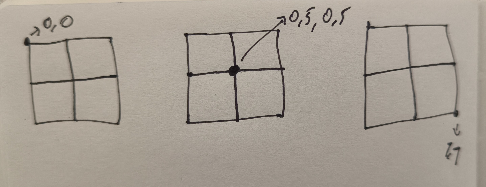
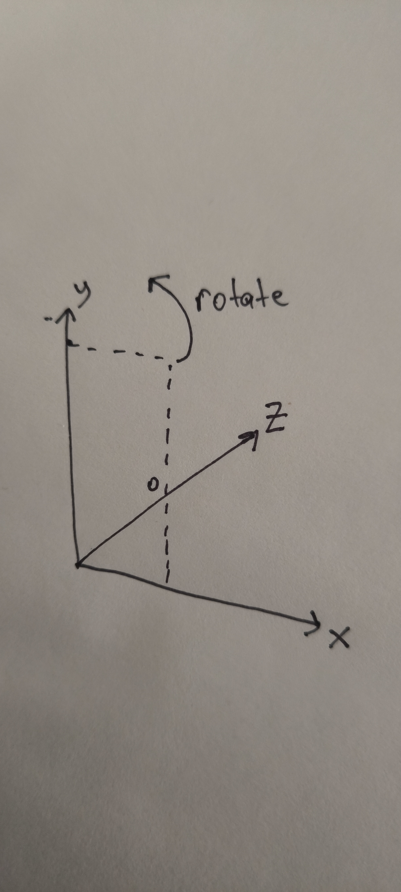

# Core Animation

Core Animation is a powerful API that integrates with your views to make animations smooth and efficient. It achieves this by caching your view's content into bitmaps that can be manipulated directly by the GPU, so your drawing code doesn't need to run on every frame.

# CALayer

Layer objects are part of the Core Animation. They are capture the content and cache it in a bitmap. When we animate, we are just changing the state information of the layer, not redrawing it. Core Animation then passes that bitmap and the new state to the GPU to render efficiently.

For example:

- Window -> View -> UIImageView -> Layer

We can create animations and add them to our view's layer, which allows us to achieve basic animations.

# Anchor Point

[The anchor point](<https://developer.apple.com/documentation/QuartzCore/CALayer/anchorPoint>)  is the point from which position are calculated, expressed in unit coordinates (0.0 to 1.0). By default it is (0.5, 0.5). For example, if you want to rotate your image, it doesn't have to rotate from the center, you can rotate it from the start or the end.



Changing anchorPoint

```swift

let reference = UIImageView(image: .init(named: "door"))    
let layer = reference.layer
layer.anchorPoint = CGPoint(x: 0.0, y: 0.5)    
                    
```

# Animating View

Here, I want to show a simple door opening animation using a CABasicAnimation with a rotation transform. Layers use a coordinate system. To achieve a door-opening effect, we should rotate along the y-axis.

Imagine placing the door image at the beginning of the window and rotating it on the y-axis; it will appear like the door is opening.



# Implementation

First, we get the layer of our reference image view. Then we store the current position of the layer, because we need to preserve the initial state before manipulating it.

To achieve this, we calculate the distance from the center to the left edge and subtract it from the old x-position, so that the left edge remains in place.

To rotate our layer, we can use CATransform3D by creating a CABasicAnimation with the  ["transform.rotation.y" keyPath.](<https://developer.apple.com/library/archive/documentation/Cocoa/Conceptual/CoreAnimation_guide/Key-ValueCodingExtensions/Key-ValueCodingExtensions.html>)

[CATransform3D](<https://developer.apple.com/documentation/quartzcore/catransform3dmakerotation(_:_:_:_:)>)  values are in radians rather than degrees, so we provide values in radians.

```swift

final class DoorOpenAnimator {
    private let duration = 2.5
    
    func animate(_ reference: UIImageView) {
        let layer = reference.layer
        
        let oldPosition = layer.position
        layer.anchorPoint = CGPoint(x: 0.0, y: 0.5)
        
        let distanceFromCenterToLeftEdge = reference.bounds.width / 2
        
        layer.position = CGPoint(
            x: oldPosition.x - distanceFromCenterToLeftEdge,
            y: oldPosition.y
        )
        
        let animation = CABasicAnimation(keyPath: "transform.rotation.y")
        animation.fromValue = 0
        animation.toValue = -Double.pi / 2
        animation.duration = duration
        animation.repeatCount = .infinity
        animation.autoreverses = true
        
        layer.add(animation, forKey: "doorOpen")
    }
}
                    
```

# Demo

<video class="video" controls="">
    <source src="/asset/core-animation-ca-transform-3d/demo.mp4" type="video/mp4">
    Your browser does not support the video tag.
</video>

# Conclusion

No doubt we can achieve much better animation, transition with Core Animation. I enjoyed experimenting with this API. You can find more details  [here](<https://developer.apple.com/library/archive/documentation/Cocoa/Conceptual/CoreAnimation_guide/Introduction/Introduction.html#//apple_ref/doc/uid/TP40004514-CH1-SW1>)  .
