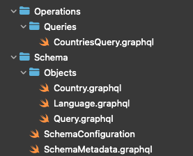
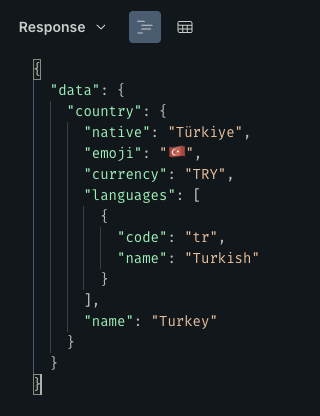

In this blog post, I will walk you through implementing GraphQL on a native iOS client and share tips to make the integration easier.

# GraphQL

GraphQL is an API query language created by Meta that enables clients to retrieve exactly the data they need through a single endpoint.

GraphQL operations are categorized into three types:

- Query – Used to fetch data (similar to GET).
- Mutation – Used to modify data (CREATE, UPDATE, DELETE).
- Subscription – Enables real-time updates from the server to the client. This allows the client to listen for changes actively.

## Query

A query specifies the data you want from the server. You define the operation type, give it a name, and select the fields you want returned. One of the major advantages of GraphQL is that you don’t need to overfetch data you only retrieve what you request. Moreover, response structures can be auto-generated on the client side using tools like Apollo.

```graphql

query QueryCurrentUser {
  currentUser {
    name
    age
  }
}

```

You can also combine multiple queries into a single request:

```graphql

query QueryCurrentUserAndTransactions {
  currentUser {
    name
    age
  }
  transactions {
    id
    amount
    date
 }
}

```

## Mutation

Mutations allow you to send input data to the server to create, update, or delete resources.

```graphql

mutation CreateUser($name: String!, $age: Int!) {
  createUser(userName: $name, age: $age) {
    name
    age
  }
}

```

## Subscription

Subscriptions allow clients to receive live updates when data changes on the server.

```graphql

subscription {
  newUser {
    name
    age
  }
}

```

## Advantages of GraphQL

- Fetch exactly the data the client needs.
- Combine multiple requests into a single query.
- Single endpoint
- With libraries like Apollo Client, you don’t need to manually write models or response parsing code much of it is generated automatically.

# Apollo Client

[Apollo Client](<https://www.apollographql.com/>)  is a popular, actively maintained GraphQL library that supports multiple platforms, including iOS, Android, and web frameworks like Angular, Vue, and Svelte. It provides tools for schema management, code generation, and network handling.

Now let's look at iOS implementation.

## Step 1: Download the Schema File

The schema defines the types and relationships in your GraphQL server. You can download it in JSON or SDL (raw) format.

For example, on any public  [website](<https://studio.apollographql.com/public/countries/variant/current/schema/sdl>)  you can download the JSON and RAW formats of your schema from the "Schema" section on the left.

## Step 2: Add Apollo Client & CLI

Open your Xcode project, right-click on your project, and select "Add Package Dependencies…". After that, enter the repository link  [apollo-ios](<https://github.com/apollographql/apollo-ios>)  and add it. Later on just, select Apollo and add it to your target.

After successful dependency adding operation right click again to your project and click Install CLI.

## Step 3: Create Apollo Codegen Config

To be able to get our generated files, we need to create this config JSON file and configure it. Later, we will use the CLI together with this config to generate our files.

Run the following command in your project root directory:

`./apollo-ios-cli init --schema-namespace ${MySchemaName} --module-type ${ModuleType}`

\`MySchemaName\` will be used as the top-level file name (for example, MySchemaName.GetCurrentUser), so choose it according to your needs.

I used the following command for my setup, but for more detailed documentation,  [refer](<https://www.apollographql.com/docs/ios/get-started#install-the-codegen-cli-1:~:text=Install-,the,-Codegen%20CLI>)  to the Apollo Client website.

`./apollo-ios-cli init --schema-namespace CountryAPI --module-type embeddedInTarget --target-name MyDemoApp`

## Step 4: Create .graphql File

Our schema file can contain all potential types and relationships, but our application might not need all those operations. Therefore, we don’t need to generate large files. To achieve this, we must create client-specific .graphql files.

In my example, I hardcoded the country code in the query, but you can also pass it as a parameter. To create the file, simply create an empty file in Xcode with the \`.graphql\` extension and place it wherever you want. Make sure to configure it properly in the Apollo Codegen config file so that cli command can find the .graphql file.

```graphql

query CountriesQuery {
  country(code: "TR") {
    name
    native
    emoji
    currency
    languages {
      code
      name
    }
  }
}

```

## Step 5: Update Apollo Codegen Config File

This step can be a bit tricky, as you may encounter various errors related to file paths, missing JSON objects, and other issues. Some research might be required. Since I am using a \`.json\` file as the schema, I had to update the \`schemaSearchPaths\` section.

```json

{
  "schemaNamespace": "CountryAPI",
  "input": {
    "operationSearchPaths": [
      "**/*.graphql"
    ],
    "schemaSearchPaths": [
      "./schema.json"
    ]
  },
  "output": {
    "testMocks": {
      "none": {}
    },
    "schemaTypes": {
      "path": "./CountryAPI",
      "moduleType": {
        "embeddedInTarget": {
          "name": "MyDemoApp"
        }
      }
    },
    "operations": {
      "inSchemaModule": {}
    }
  }
}

```

## Step 6: Generate Swift Files

Run this command:

`` `./apollo-ios-cli generate` ``

This will create a new folder in your project’s root directory if everything goes well.

## Step 7: Import Generated Folder

After generating the folder, drag and drop it into your Xcode project and add it to your target. Once imported, you can use the generated files to implement networking code.



## iOS Implementation

```swift

import Apollo

protocol NetworkProtocol {
    var client: ApolloClient { get }
}

final class Network: NetworkProtocol {
    private(set) lazy var client: ApolloClient = {
        let url = URL(string: "https://countries.trevorblades.com/graphql")!
        return ApolloClient(url: url)
    }()
}

protocol CountryRepository {
    func fetchCountry() async throws -> CountryAPI.CountriesQuery.Data.Country?
}

struct CountryRemoteRepository: CountryRepository {

    private let api: NetworkProtocol

    init(api: NetworkProtocol) {
        self.api = api
    }

    func fetchCountry() async throws -> CountryAPI.CountriesQuery.Data.Country? {
        try await withCheckedThrowingContinuation { continuation in
            api.client.fetch(query: CountryAPI.CountriesQuery()) { result in
                switch result {
                case .success(let response):
                    continuation.resume(returning: response.data?.country)
                case .failure(let error):
                    continuation.resume(throwing: error)
                }
            }
        }
    }
}

```



# Conclusion

GraphQL offers a flexible and efficient approach, enabling clients to request precisely the data they need in a single query.

Apollo Client makes integration on iOS and other platforms easier by generating Swift types and handling networking. While setting up Apollo on a native iOS project can be error-prone initially nevertheless good to learn and fun to use.

You can check this  [website](<https://graphql.org/community/tools-and-libraries/>)  for more tools and libraries.
