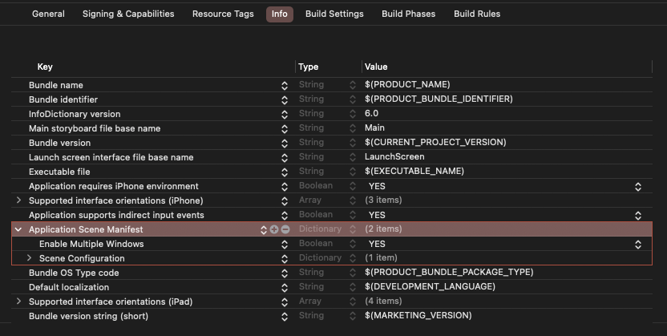
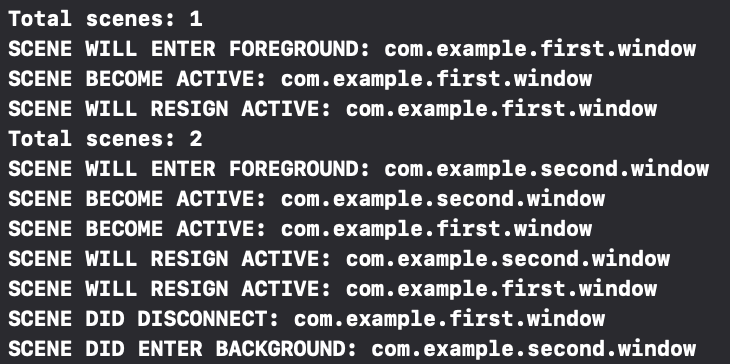

Most apps respond to changes in its execution state launching, entering the background, receiving notifications, and more. Since iOS 13, Apple has introduced  [Scenes](<https://developer.apple.com/documentation/uikit/scenes>)  for window lifecycle management alongside the traditional  [UIApplicationDelegate](<https://developer.apple.com/documentation/uikit/uiapplicationdelegate>)  .In this post, we’ll explore both approaches, clarify their responsibilities, and build a simple multi-window demo in UIKit.

# The Role of UIApplicationDelegate

The  [UIApplicationDelegate](<https://developer.apple.com/documentation/uikit/uiapplicationdelegate>)  protocol defines methods for handling high-level events in your app’s life cycle.

- App launch and termination
- Entering the background and returning to the foreground
- Receiving a memory warning from the system
- Push-notification registration (APNs)
- ... and much more

Most of us work with single window apps and implement common methods such as initializing the UIWindow, setting the root view controller, and registering for  [Apple Push Notification Service (APNs).](<https://developer.apple.com/documentation/usernotifications/registering-your-app-with-apns>)  I'm pretty sure you've written the code below. It just worked for you, but I want to dive a bit deeper and understand it better.

```swift

import UIKit

final class AppDelegate: UIResponder, UIApplicationDelegate {

    var window: UIWindow?

    func application(_ application: UIApplication,
                     didFinishLaunchingWithOptions launchOptions: [UIApplication.LaunchOptionsKey: Any]?) -> Bool {
        window = UIWindow(frame: UIScreen.main.bounds)
        let rootVC = ViewController()
        window?.rootViewController = rootVC
        window?.makeKeyAndVisible()

        return true
    }

    func application(_ application: UIApplication,
                     didRegisterForRemoteNotificationsWithDeviceToken deviceToken: Data) {
        print("Device Token: \(deviceToken)")
    }

    func application(_ application: UIApplication,
                     didFailToRegisterForRemoteNotificationsWithError error: Error) {
        print("Failed to register: \(error.localizedDescription)")
    }
}

```

# Why an Array of UIWindow Isn’t Enough?

We have a  [UIWindow](<https://developer.apple.com/documentation/uikit/uiwindow>)  , a  [UINavigationController](<https://developer.apple.com/documentation/uikit/uinavigationcontroller>)  , and then  [UIViewControllers](<https://developer.apple.com/documentation/uikit/uiviewcontroller>)  within it. This makes perfect sense to me. Each UIViewController contains a bunch of  [UIViews](<https://developer.apple.com/documentation/uikit/uiview>)  , allowing us to build our screens in a structured way.

If we need to show multiple windows with different navigation hierarchies, why can't we just add another UIWindow? Why do we need Scenes, SceneDelegate?

Before iOS 13, you could create multiple UIWindow instances, but all lifecycle methods  [applicationWillResignActive(_:)](<https://developer.apple.com/documentation/uikit/uiapplicationdelegate/applicationwillresignactive(_:)>)  ,  [applicationDidEnterBackground(_:)](<https://developer.apple.com/documentation/uikit/uiapplicationdelegate/applicationdidenterbackground(_:)>)  , etc. still funneled through a single AppDelegate. You could not determine which window was moving to the background or becoming active.

# SceneDelegate

The  [UISceneDelegate](<https://developer.apple.com/documentation/uikit/uiscenedelegate>)  handles scene-level events, whereas AppDelegate manages app-wide lifecycle events.

With Scenes, each window is managed by its own UIScene. For example, if you have two windows, each fires its own lifecycle callbacks:

- [sceneDidDisconnect(_:)](<https://developer.apple.com/documentation/uikit/uiscenedelegate/scenediddisconnect(_:)>)
- [sceneDidBecomeActive(_:)](<https://developer.apple.com/documentation/uikit/uiscenedelegate/scenedidbecomeactive(_:)>)
- [sceneWillEnterForeground(_:)](<https://developer.apple.com/documentation/uikit/uiscenedelegate/scenewillenterforeground(_:)>)
- ... and more

You can now save, restore, and synchronize state on a per window basis something you simply cannot achieve by juggling naked UIWindow objects.

# Building a Simple Multi-Window App

By default, when you create an application, the  [Info.plist](<https://developer.apple.com/documentation/bundleresources/information-property-list>)  file contains a key called Application Scene Manifest, which includes a boolean value named Enable Multiple Windows. This value is set to false by default. To support multiple windows, you first need to enable this option. Of course, this feature is only available starting from iOS 13.0+, iPadOS 13.0+, Mac Catalyst 13.1.



## AppDelegate Implementation

Connect scenes by returning a configuration for each new session

```swift

import UIKit

@main
final class AppDelegate: UIResponder, UIApplicationDelegate {

    func application(_ application: UIApplication,
                     didFinishLaunchingWithOptions launchOptions: [UIApplication.LaunchOptionsKey: Any]?) -> Bool {
        // Override point for customization after application launch.
        return true
    }

    // MARK: UISceneSession Lifecycle

    func application(_ application: UIApplication,
                     configurationForConnecting connectingSceneSession: UISceneSession,
                     options: UIScene.ConnectionOptions) -> UISceneConfiguration {
        return UISceneConfiguration(name: "Default Configuration",
                                    sessionRole: connectingSceneSession.role)
    }

    func application(_ application: UIApplication,
                     didDiscardSceneSessions sceneSessions: Set<UISceneSession>) {
        // Called when the user discards a scene session.
    }
}
  
```

## Windows Enum

```swift

import Foundation

enum Windows: String {
   case firstWindow = "com.example.first.window"
   case secondWindow = "com.example.second.window"
   case thirdWindow = "com.example.third.window"
}
   
```

## Scene Delegate Implementation

I'm setting the root view controller of the active window based on the window type. The UIWindowSceneDelegate protocol provides functions that allow me to run specific code for the  [UIWindow](<https://developer.apple.com/documentation/uikit/uiwindow>)  .

```swift

import UIKit

final class SceneDelegate: UIResponder, UIWindowSceneDelegate {

   var window: UIWindow?
   var windowType: Windows = .firstWindow

   func scene(_ scene: UIScene, willConnectTo session: UISceneSession, options connectionOptions: UIScene.ConnectionOptions) {
       guard let windowScene = scene as? UIWindowScene else { return }

       let window = UIWindow(windowScene: windowScene)
       if let activityType = connectionOptions.userActivities.first?.activityType {
           switch activityType {
           case Windows.firstWindow.rawValue:
               window.rootViewController = ViewController()
               windowType = .firstWindow
           case Windows.secondWindow.rawValue:
               window.rootViewController = SecondViewController()
               windowType = .secondWindow
           case Windows.thirdWindow.rawValue:
               window.rootViewController = ThirdViewController()
               windowType = .thirdWindow
           default:
               window.rootViewController = ViewController()
               windowType = .firstWindow
           }
       } else {
           window.rootViewController = ViewController()
           windowType = .firstWindow
       }

       self.window = window
       window.makeKeyAndVisible()

       let appWindowScenes = UIApplication.shared.connectedScenes
           .compactMap { $0 as? UIWindowScene }

       print("Total scenes: \(appWindowScenes.count)")
   }

   private func getWindowName(_ scene: UIScene) -> String {
       return windowType.rawValue
   }

   func sceneDidDisconnect(_ scene: UIScene) {
       print("SCENE DID DISCONNECT: \(getWindowName(scene))")
   }

   func sceneDidBecomeActive(_ scene: UIScene) {
       print("SCENE BECOME ACTIVE: \(getWindowName(scene))")
   }

   func sceneWillResignActive(_ scene: UIScene) {
       print("SCENE WILL RESIGN ACTIVE: \(getWindowName(scene))")
   }

   func sceneWillEnterForeground(_ scene: UIScene) {
       print("SCENE WILL ENTER FOREGROUND: \(getWindowName(scene))")
   }

   func sceneDidEnterBackground(_ scene: UIScene) {
       print("SCENE DID ENTER BACKGROUND: \(getWindowName(scene))")
   }
}
   
```

## ViewControllers

They each contain a button, and each button calls the extension function.

```swift

final class ViewController: UIViewController {
   override func viewDidLoad() {
       super.viewDidLoad()
       view.backgroundColor = .black

       let button = UIButton(type: .system, primaryAction: UIAction(title: "Open Second Window", handler: { _ in
           self.openNewScene(.secondWindow)
       }))
       button.translatesAutoresizingMaskIntoConstraints = false
       view.addSubview(button)

       NSLayoutConstraint.activate([
           button.centerXAnchor.constraint(equalTo: view.centerXAnchor),
           button.centerYAnchor.constraint(equalTo: view.centerYAnchor)
       ])
   }
}

final class SecondViewController: UIViewController {
   override func viewDidLoad() {
       super.viewDidLoad()
       view.backgroundColor = .orange

       let button = UIButton(type: .system, primaryAction: UIAction(title: "Open Third Window", handler: { _ in
           self.openNewScene(.thirdWindow)
       }))
       button.translatesAutoresizingMaskIntoConstraints = false
       view.addSubview(button)

       NSLayoutConstraint.activate([
           button.centerXAnchor.constraint(equalTo: view.centerXAnchor),
           button.centerYAnchor.constraint(equalTo: view.centerYAnchor)
       ])
   }
}

final class ThirdViewController: UIViewController {
   override func viewDidLoad() {
       super.viewDidLoad()
       view.backgroundColor = .red

       let button = UIButton()
       button.setTitle("Third View Controller", for: .normal)
       button.translatesAutoresizingMaskIntoConstraints = false
       view.addSubview(button)

       NSLayoutConstraint.activate([
           button.centerXAnchor.constraint(equalTo: view.centerXAnchor),
           button.centerYAnchor.constraint(equalTo: view.centerYAnchor)
       ])
   }
}
   
```

With this ViewController  [extension](<https://docs.swift.org/swift-book/documentation/the-swift-programming-language/extensions/>)  , I'm sending a request to the system for a new scene via  [NSUserActivity](<https://developer.apple.com/documentation/foundation/nsuseractivity>)

```swift

import UIKit.UIViewController

extension UIViewController {
   func openNewScene(_ window: Windows) {
       let activity = NSUserActivity(activityType: window.rawValue)
       activity.userInfo = ["windowName": window.rawValue]
       UIApplication.shared.requestSceneSessionActivation(nil, userActivity: activity, options: nil) { error in
           print("Failed to open new scene: \(error.localizedDescription)")
       }
   }
}
   
```

# Demo

<video class="video" controls="">
    <source src="/asset/managing-app-life-cycle/iPad_Mini_Demo.mp4" type="video/mp4">
    Your browser does not support the video tag.
</video>



# Conclusion

I find this separation quite helpful and easy to use. However, some of the terminology can be confusing and lead to misunderstandings. Over time, operating systems evolve, and we have to keep up with new changes.

I hope to find time soon to share content related to WWDC25.
