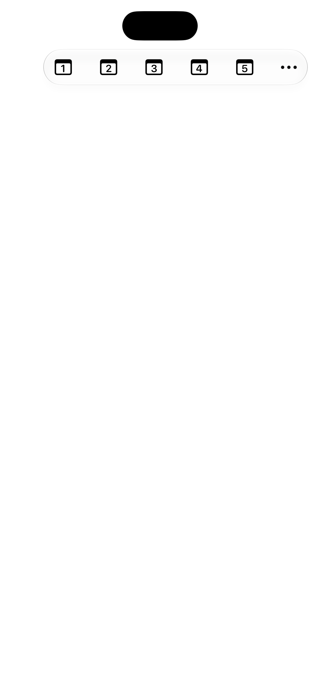
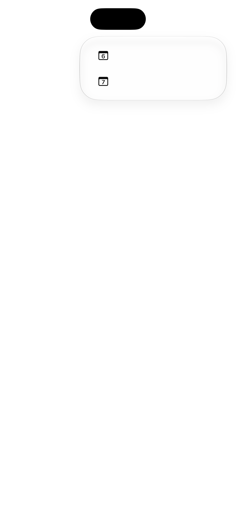
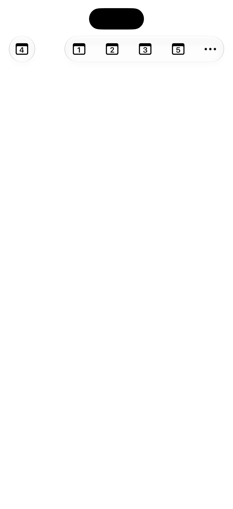
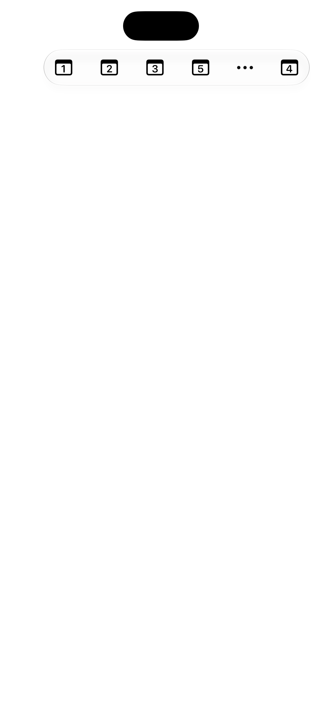
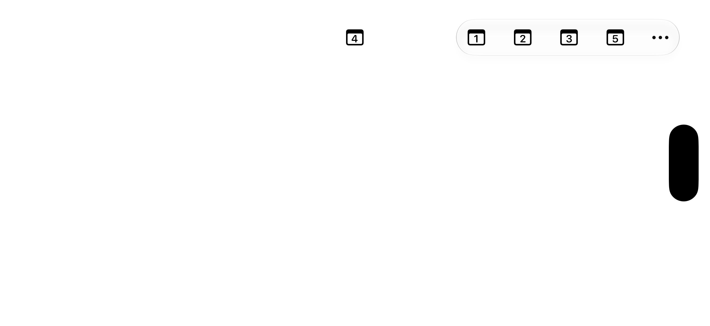
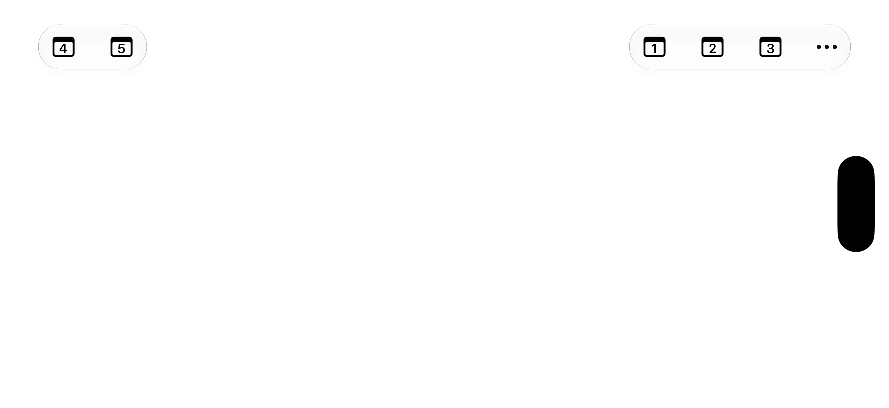
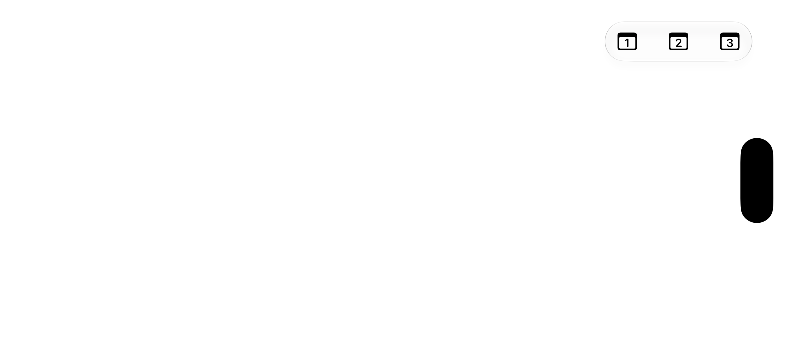

Getting the toolbar placement you want in SwiftUI can be tiring. In this blog post, I'll try to make it clearer with a few examples.

# Toolbar view modifier

For these examples, we need a `NavigationStack` to host the navigation bar. Adding `.toolbar` to a standalone view does not create a navigation bar by itself.

Instead of this:

```swift
ZStack {
    Color.white
}
.toolbar {
    ToolbarItem {
        Text("Calendar")
    }
}
```

We can do this:

```swift
NavigationStack {
    ZStack {
        Color.white
    }
    .toolbar {
        ToolbarItem {
            Text("Calendar")
        }
    }
}
```

A macOS window can host toolbar items without a `NavigationStack`, as shown in the [toolbar documentation](https://developer.apple.com/documentation/swiftui/view/toolbar%28content%3A%29).

# ToolbarItem

`ToolbarItem` wraps a view inside the `.toolbar` modifier. Its content can be text, a button with an SF Symbol, or another control.

```swift
NavigationStack {
    ZStack {
        Color.white
    }
    .toolbar {
        ToolbarItem {
            Button {
            } label: {
                Image(systemName: "1.calendar")
            }
        }
    }
}
```

What happens if we add seven `ToolbarItem`s?

The system can move items that do not fit into an overflow menu. Placement and context also affect their order.

```swift
NavigationStack {
    ZStack {
        Color.white
    }
    .toolbar {
        ForEach(1...7, id: \.self) { day in
            ToolbarItem {
                Button {
                } label: {
                    Image(systemName: "\(day).calendar")
                }
            }
        }
    }
}
```

## Output


In my test, tapping the overflow button did not open a menu. That was an observed issue, not the intended overflow behavior.

# ToolbarOverflowMenu

Now let's look at [ToolbarOverflowMenu](https://developer.apple.com/documentation/swiftui/toolbaroverflowmenu), available on iOS 27.0+, iPadOS 27.0+, Mac Catalyst 27.0+, and visionOS 27.0+.

Use it for actions that should always appear in the overflow menu, even when the toolbar has enough room. Put the buttons directly inside it, without wrapping them in `ToolbarItem`.

```swift
NavigationStack {
    ZStack {
        Color.white
    }
    .toolbar {
        ForEach(1...5, id: \.self) { day in
            ToolbarItem {
                Button {
                } label: {
                    Image(systemName: "\(day).calendar")
                }
            }
        }

        ToolbarOverflowMenu {
            Button {
            } label: {
                Image(systemName: "6.calendar")
            }
            Button {
            } label: {
                Image(systemName: "7.calendar")
            }
        }
    }
}
```

## Output





# ToolbarItemPlacement

Now we can choose a placement for each toolbar item using `ToolbarItemPlacement`.

The [placement reference](https://developer.apple.com/documentation/swiftui/toolbaritemplacement) is long. Some placements describe a purpose; others specify a position. SwiftUI also considers the platform and available space.

For example, in my portrait test, assigning `.navigation`, `.cancellationAction`, or `.principal` to the `4.calendar` button appeared to produce a similar layout:



This was my observed result. It does not make the placements interchangeable: `.principal` is documented as centered.

When I assigned [.topBarPinnedTrailing](https://developer.apple.com/documentation/swiftui/toolbaritemplacement/topbarpinnedtrailing) to the same button, it moved after the overflow button:



Available from iOS 27.0, this placement anchors the item at the trailing edge. Pinned items only enter overflow when search is active and space is insufficient.

When I rotated the device to landscape, I could clearly see the [.principal](https://developer.apple.com/documentation/swiftui/toolbaritemplacement/principal) item in the center:



On iPhone and iPad, [.navigation](https://developer.apple.com/documentation/swiftui/toolbaritemplacement/navigation) and [.cancellationAction](https://developer.apple.com/documentation/swiftui/toolbaritemplacement/cancellationaction) normally appear at the leading edge. With a system Back button in compact width, `.navigation` instead uses the primary-action position.

When I included both placements, the cancellation item appeared before the navigation item in this layout:



That order is specific to this example. For Cancel in an iPhone or iPad sheet, use `.cancellationAction` for leading placement. In macOS sheets, it appears trailing, before confirmation actions. We still implement the button's action.

## What's the difference between cancellation and destructive actions?

`.cancellationAction` abandons an operation; [.destructiveAction](https://developer.apple.com/documentation/swiftui/toolbaritemplacement/destructiveaction) represents an action such as Don't Save. In an edited document, Cancel keeps you editing, while Don't Save discards the edits.

On iOS, cancellation items appear leading and destructive items trailing. In macOS sheets, destructive items appear leading and cancellation items trailing, before confirmation actions.

# ToolbarItemGroup

[ToolbarItemGroup](https://developer.apple.com/documentation/swiftui/toolbaritemgroup) lets us put related controls next to each other without repeating `ToolbarItem` around every button. Each control still becomes a toolbar item.

```swift
NavigationStack {
    ZStack {
        Color.white
    }
    .toolbar {
        ToolbarItemGroup {
            Button {
            } label: {
                Image(systemName: "1.calendar")
            }
            Button {
            } label: {
                Image(systemName: "2.calendar")
            }
            Button {
            } label: {
                Image(systemName: "3.calendar")
            }
        }
    }
}
```

## Output



# ToolbarRole

This part is interesting. [.browser](https://developer.apple.com/documentation/swiftui/toolbarrole/browser) describes a toolbar for navigating content; [.editor](https://developer.apple.com/documentation/swiftui/toolbarrole/editor.md) describes one for editing document-like content.

I tested both on iPadOS 27.2 and iOS 27.2 but could not see a visual difference. Both use a leading-aligned title and allow center toolbar items on iPadOS. Editor also documents a custom Back-button appearance, which looked the same in my test.

Here is the comparison view. This result does not prove the roles are identical everywhere. Feel free to share a case where the difference is visible.

```swift
struct ToolbarDemo: View {
    var body: some View {
        NavigationStack {
            List {
                NavigationLink("Open") {
                    ToolbarRoleComparison()
                }
            }
        }
    }
}

private struct ToolbarRoleComparison: View {
    @State private var role: DemoToolbarRole = .browser

    var body: some View {
        Section("Toolbar role") {
            Picker("Role", selection: $role) {
                ForEach(DemoToolbarRole.allCases) { role in
                    Text(role.rawValue).tag(role)
                }
            }
            .pickerStyle(.menu)
        }
        .navigationTitle("Title")
        .navigationBarTitleDisplayMode(.inline)
        .toolbar {
            ToolbarItem {
                Button("Calendar 1", systemImage: "1.calendar") {}
            }
            ToolbarItem {
                Button("Calendar 2", systemImage: "2.calendar") {}
            }
            ToolbarItem {
                Button("Calendar 3", systemImage: "3.calendar") {}
            }
        }
        .toolbarRole(role.value)
    }
}

private enum DemoToolbarRole: String, CaseIterable, Identifiable {
    case automatic = "Automatic"
    case navigationStack = "Navigation Stack"
    case browser = "Browser"
    case editor = "Editor"

    var id: Self { self }

    var value: ToolbarRole {
        switch self {
        case .automatic: .automatic
        case .navigationStack: .navigationStack
        case .browser: .browser
        case .editor: .editor
        }
    }
}
```
