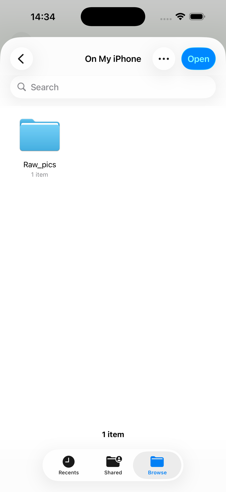

In this post, we’ll explore Apple’s **FileManager API**, one of the most fundamental and widely used components of the Foundation framework. Understanding how it works is essential for any iOS or macOS developer who needs to interact with the file system.

Before diving into FileManager, we’ll start with **URL**, since most file system operations are performed using URL objects. Understanding URLs gives us the foundation to work confidently with files and directories in Apple’s platforms.

# URL & NSURL

A `URL` represents the location of a resource, it can refer to a file on disk or a remote resource on the network. In Swift, `URL` is implemented as a *struct*, while `NSURL` is its Objective-C counterpart, implemented as a *class*.

When working with remote resources, you’ll typically use  [URL Loading System](<https://developer.apple.com/documentation/foundation/url-loading-system>)  often through  [URLSession](<https://developer.apple.com/documentation/foundation/urlsession>) , to fetch or upload data.

A `URL` can also be broken down into its individual components, such as scheme, host, port, path, and query parameters:

```swift

private func test() {
    let url: NSURL = .init(string: "https://lion.den@example.com:8080/info;param=pValue?query=qValue")! as NSURL
    print(url.scheme) // "https"
    print(url.user) // "lion.den"
    print(url.host) // "example.com"
    print(url.port) // 8080
    print(url.query) // "query=qValue"
    print(url.path) // "/info;param=pValue"
}

```

# Security-Scoped URLs

A **security-scoped URL** is a special type of URL that allows your app to access files and folders located outside of its sandbox. For example, when using  [UIDocumentPickerViewController](<https://developer.apple.com/documentation/UIKit/UIDocumentPickerViewController>) , the user can pick files or folders stored elsewhere on the device, such as in the Files app.

The code below shows how to present a document picker that allows the user to select a folder. Once the user makes a selection, we gain temporary permission to read its contents by calling  [startAccessingSecurityScopedResource()](<https://developer.apple.com/documentation/foundation/nsurl/startaccessingsecurityscopedresource()>)  . After that, we can use `FileManager` to access the files inside that folder safely.

```swift

extension GalleryViewController: UIDocumentPickerDelegate {
    private func showFolderPicker() {
        let picker = UIDocumentPickerViewController(forOpeningContentTypes: [.folder], asCopy: false)
        picker.delegate = self
        picker.allowsMultipleSelection = false
        present(picker, animated: true)
    }

    func documentPicker(_ controller: UIDocumentPickerViewController, didPickDocumentsAt urls: [URL]) {
        guard let folderURL = urls.first else { return }
        loadImages(from: folderURL)
    }

    private func loadImages(from folderURL: URL) {
        guard folderURL.startAccessingSecurityScopedResource() else { return }
        defer { folderURL.stopAccessingSecurityScopedResource() }

        do {
            let contents = try FileManager.default.contentsOfDirectory(at: folderURL, includingPropertiesForKeys: nil)

            let imageURLs = contents.filter { url in
                let ext = url.pathExtension.lowercased()
                return ["jpg", "jpeg", "png", "heic"].contains(ext)
            }

            gallerySource = imageURLs.map { $0.path }

            DispatchQueue.main.async {
                self.galleryCollectionView.reloadData()
            }
        } catch {
            print("Error reading folder contents:", error)
        }
    }
}

```

Understanding `URL` and how it represents both local and remote resources is essential before diving into `FileManager`. They work hand in hand: `URL` defines *where* something is, and `FileManager` defines *what* you can do with it.

Think of them as building blocks, small, simple components that combine to form powerful systems.



# FileManager

The `FileManager` API allows you to access, read, write, copy, and delete files both inside your app’s sandbox and, with proper permissions, outside of it. The system defines multiple directory types for different purposes, which we’ll examine below.

## User Directories

You can easily access your app’s temporary and home directories through either `FileManager` or the older Foundation functions in `NSPathUtils`. Note that while both give similar paths, their representations differ slightly (e.g. one returns a `URL` and the other a `String`).

```swift

private func printUserDirectories() {
   print(FileManager.default.temporaryDirectory) // file:///Users/testuser/Library/Developer/CoreSimulator/Devices/C23A251B-67F8-46ED-9DA4-FB8F72670E6E/data/Containers/Data/Application/FF7BEF5B-858B-48EF-ADA9-19B9D53D1274/tmp/
   print(NSTemporaryDirectory()) // /Users/testuser/Library/Developer/CoreSimulator/Devices/C23A251B-67F8-46ED-9DA4-FB8F72670E6E/data/Containers/Data/Application/FF7BEF5B-858B-48EF-ADA9-19B9D53D1274/tmp/

   print(NSHomeDirectory()) // /Users/testuser/Library/Developer/CoreSimulator/Devices/C23A251B-67F8-46ED-9DA4-FB8F72670E6E/data/Containers/Data/Application/FF7BEF5B-858B-48EF-ADA9-19B9D53D1274
}

```

## Working with System Directories

Two of the most useful FileManager functions are `url(for:in:)` and `urls(for:in:)`. These allow you to locate predefined system directories by specifying both a `SearchPathDirectory` (the type of directory) and a `SearchPathDomainMask` (the domain or scope where it exists).

`SearchPathDirectory` is an enumeration that includes many directory types, such as:

- documentDirectory
- applicationDirectory
- applicationSupportDirectory
- adminApplicationDirectory
- libraryDirectory
- userDirectory
- documentationDirectory
- cachesDirectory
- …and more

At first, these options may seem confusing, but once you understand what each represents, choosing the correct one becomes straightforward.

For example:

- **Documents Directory** → for files that the user creates or interacts with directly.
- **Application Support Directory** → for configuration or internal files used by the app itself.
- **Caches Directory** → for temporary data that improves performance and can be safely deleted.

The second parameter, **SearchPathDomainMask**, determines *where* the system looks for these directories, for example, in the local domain, the system domain, or the network domain.

## Implementation

The following code demonstrates the simple crud operations.

```swift

struct FileManagerUtil {
    private let fileManager = FileManager.default

    private var documentsDirectory: URL {
        fileManager.urls(for: .documentDirectory, in: .userDomainMask)[0]
    }

    private func fileURL(for name: String) -> URL {
        documentsDirectory.appendingPathComponent(name)
    }

    func createFile(named name: String, content: String) {
        let fileURL = fileURL(for: name)
        let data = Data(content.utf8)

        do {
            try data.write(to: fileURL)
            print("✅ Created file at: \(fileURL.path)")
        } catch {
            print("❌ Failed to create file:", error)
        }
    }

    func readFile(named name: String) -> String? {
        let fileURL = fileURL(for: name)

        do {
            let data = try Data(contentsOf: fileURL)
            let text = String(decoding: data, as: UTF8.self)
            print("📖 File contents:\n\(text)")
            return text
        } catch {
            print("❌ Failed to read file:", error)
            return nil
        }
    }

    func updateFile(named name: String, newContent: String) {
        let fileURL = fileURL(for: name)

        guard fileManager.fileExists(atPath: fileURL.path) else {
            print("⚠️ File doesn’t exist to update.")
            return
        }

        do {
            try newContent.write(to: fileURL, atomically: true, encoding: .utf8)
            print("✏️ Updated file at: \(fileURL.path)")
        } catch {
            print("❌ Failed to update file:", error)
        }
    }

    func deleteFile(named name: String) {
        let fileURL = fileURL(for: name)

        guard fileManager.fileExists(atPath: fileURL.path) else {
            print("⚠️ File doesn’t exist to delete.")
            return
        }

        do {
            try fileManager.removeItem(at: fileURL)
            print("🗑️ Deleted file at: \(fileURL.path)")
        } catch {
            print("❌ Failed to delete file:", error)
        }
    }

    func listDocumentsDirectory() {
        do {
            let contents = try fileManager.contentsOfDirectory(at: documentsDirectory, includingPropertiesForKeys: nil)
            print("📂 Documents Directory Contents:")
            contents.forEach { print("  • \($0.lastPathComponent)") }
        } catch {
            print("❌ Failed to list directory:", error)
        }
    }
}

```

Example usage:

```swift

let key = "my_secret_file"

// Each app instance gets a unique sandbox path (UUID in the path), so this can change between installs/runs. That's why you are seeing different UUID in the test but once you try yourself you will see the exact results.

// ✅ Created file at: /Users/testuser/Library/Developer/CoreSimulator/Devices/C23A251B-67F8-46ED-9DA4-FB8F72670E6E/data/Containers/Data/Application/58779909-AC51-4F1C-A132-C7EDCF3F0BF3/Documents/my_secret_file
util.createFile(named: key, content: "Hello World")

// 📖 File contents: Hello World
let content = util.readFile(named: key)

// 📂 Documents Directory Contents: • my_secret_file
util.listDocumentsDirectory()

✏️ Updated file at: /Users/testuser/Library/Developer/CoreSimulator/Devices/C23A251B-67F8-46ED-9DA4-FB8F72670E6E/data/Containers/Data/Application/0A01CB66-4673-4010-A69C-652CAC776300/Documents/my_secret_file
util.updateFile(named: key, newContent: "test_2")

// 📖 File contents: test_2
util.readFile(named: key)

// 🗑️ Deleted file at: /Users/testuser/Library/Developer/CoreSimulator/Devices/C23A251B-67F8-46ED-9DA4-FB8F72670E6E/data/Containers/Data/Application/F5AD74C4-1871-44D5-9326-FFE07E8183FE/Documents/my_secret_file
util.deleteFile(named: key)

// ❌ Failed to read file: Error Domain=NSCocoaErrorDomain Code=260 "The file “my_secret_file” couldn’t be opened because there is no such file."
util.readFile(named: key)

```

# Conclusion

The **FileManager** API is one of the most powerful and essential tools provided by the Foundation framework. It serves as the backbone for managing files and directories across both macOS and iOS environments. It is a must-have skill in every Apple developer’s toolkit.
